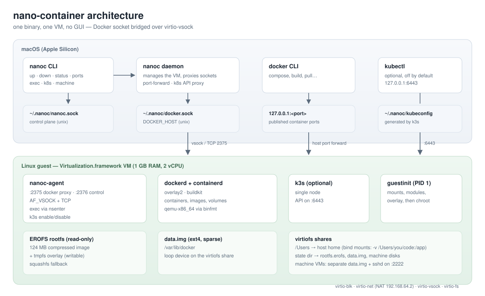

# nano-container

[](https://github.com/MELOZ-TECH/nano-container/actions/workflows/ci.yml)
[](https://github.com/MELOZ-TECH/nano-container/releases)
[](LICENSE)
[](go.mod)
[](https://meloz-tech.github.io/nano-container/)

A small, CLI-only container runtime for macOS on Apple Silicon.
It boots a minimal Linux VM through **Virtualization.framework**, runs Docker inside it,
and exposes the Docker socket to your Mac — no GUI, no SSH. Kubernetes is optional
and off by default.

> Status: **experimental**.

## Demo

`demo/demo.sh` roda a demonstração completa; `demo/nanoc-demo.cast` é uma
gravação real (asciinema) gerada por `scripts/make-demo-cast.sh`:

```sh
asciinema play demo/nanoc-demo.cast
```

Site com a documentação: <https://meloz-tech.github.io/nano-container/>

## Numbers

Measured on an Apple Silicon Mac with `./scripts/bench.sh` (median of three
clean boots, Docker image already pulled):

| Metric | Value |
|---|---|
| Boot (`nanoc up` until ready) | **17.4 s** |
| Guest RAM (total) | **968 MB** |
| Guest RAM available at idle | 676 MB |
| First `docker run` (local image) | **2.0 s** |
| `nanoc` binary | **6.1 MB** |
| EROFS rootfs | 124 MB |
| `data.img` (sparse, grows with images) | 8 GB max |
| State on disk after pulls | ~1.6 GB |

Run it yourself:

```sh
./scripts/bench.sh
```

## How it compares

Approximate, for orientation only — measure your own workload.

| | **nano-container** | Docker Desktop | Colima | Podman machine |
|---|---|---|---|---|
| Interface | CLI only | GUI + CLI | CLI | CLI |
| License | Apache-2.0 | proprietary (paid for larger orgs) | MIT | Apache-2.0 |
| VM memory (default) | **1 GB** | 2 GB+ | 2 GB | 1–2 GB |
| Docker API socket | yes | yes | yes | compatible |
| Kubernetes | optional k3s, off by default | optional | optional k3s | no |
| `linux/amd64` images | qemu/binfmt (slow) | Rosetta (fast) | qemu (slow) | qemu (slow) |
| Host bind mounts | virtiofs | virtiofs | sshfs/virtiofs | virtiofs |
| Extra Linux machines | `nanoc machine` | no | no | no |
| Runs on | Apple Silicon | Intel + Apple Silicon | Intel + Apple Silicon | Intel + Apple Silicon |

## Why

Most container runtimes for macOS bring a full Linux distribution, a GUI, an SSH
daemon and a large feature surface. `nano-container` keeps only what `docker run`
needs: a tiny guest, one daemon, one CLI, and a socket.

- VM with 1 GiB of RAM (configurable), 2 vCPU
- Alpine guest with its own PID 1 (`guestinit`), no systemd, no cloud-init, no sshd
- Compressed read-only root filesystem with a writable overlay
- Docker data on a btrfs image, `overlay2` storage driver
- Bridge networking with published ports working inside the VM
- Boot to a usable Docker socket in ~17 seconds (measured, see [Numbers](#numbers))

## Requirements

- Apple Silicon, macOS 14+
- Go 1.22+
- Docker CLI (`docker`) on the host
- A Docker-compatible runtime to build the guest rootfs (Docker Desktop, Colima, etc.)
- Xcode command line tools (for `codesign`)

## Quick start

```sh
# 1. fetch the kernel/initramfs/modloop and build the guest rootfs
make bootstrap

# 2. build and sign (the virtualization entitlement is mandatory)
make sign

# 3. start the VM
./nanoc up
export DOCKER_HOST=unix://$HOME/.nanoc/docker.sock

# 4. use it
docker run --rm alpine:3.22 echo hello

# 5. stop
./nanoc down
```

`nanoc status` reports the running daemon. The Docker socket lives at
`~/.nanoc/docker.sock` and the state (btrfs `data.img`, compressed rootfs) at `~/.nanoc/`.

## Commands

| Command | Description |
|---|---|
| `nanoc up` | starts the VM in a detached daemon and waits until Docker answers |
| `nanoc down` | stops the daemon/VM |
| `nanoc status` | shows whether the daemon is running |
| `nanoc doctor` | checks signature, assets, rootfs, daemon and docker socket |
| `nanoc machine <cmd>` | extra Linux VMs: `create`, `ls`, `start`, `stop`, `rm`, `exec`, `ssh` |
| `nanoc ports` | lists ports published on `127.0.0.1` |
| `nanoc exec <c> -- <cmd>` | runs a command inside a container (via the guest agent) |
| `nanoc logs <c>` | runs `docker logs` against the guest |
| `nanoc k8s enable` | starts k3s inside the guest and writes `~/.nanoc/kubeconfig` |
| `nanoc k8s disable` | stops k3s (state stays on the data image) |
| `nanoc k8s status` | shows whether Kubernetes is running |
| `nanoc k8s reset` | removes the k3s data (use if the cluster is corrupted) |

Environment variables: `NANOC_MEM_MB` (VM memory, default `1024`), `NANOC_ROOTFS`,
`NANOC_DATA`, `NANOC_MODLOOP`, `NANOC_STATE`.

## How it works



(Mermaid version in [docs/ARCHITECTURE.md](docs/ARCHITECTURE.md).)

```
nanoc CLI ──unix socket──▶ nanoc daemon ──Virtualization.framework──▶ Alpine VM
   (Go)                   (Go)                                        ├─ guestinit (PID 1)
                                                                       ├─ dockerd (overlay2)
                                                                       └─ nanoc-agent ──▶ docker.sock
```

- The guest boots an Alpine kernel with a custom initramfs whose `guestinit`:
  mounts the host share, loads kernel modules from the Alpine **modloop**, mounts the
  compressed rootfs (squashfs) read-only with a tmpfs overlay, mounts the Docker
  data image (btrfs via loop) and starts `dockerd`.
- The daemon proxies `~/.nanoc/docker.sock` to the guest over the NAT network.
- No GUI, no SSH. Kubernetes is opt-in.

### Host folders and foreign architectures

- `-v /Users/you/code:/app` works: `/Users` is shared into the guest at the same
  path, so Docker bind mounts resolve transparently.
- `linux/amd64` images run through `qemu-x86_64` registered with `binfmt_misc`
  (slow, but they run).

### Exec into containers

`docker exec` is unreliable in this guest (runc does not resolve the container
rootfs), so `nanoc exec` goes through the guest agent instead: it enters the
container namespaces with `nsenter` and runs the command there.

```sh
nanoc exec mycontainer -- uname -m
nanoc exec mycontainer -- sh -c 'ls /bin | wc -l'
```

### Published ports

`docker run -p 8080:80` works from macOS: the daemon watches the Docker API and
forwards every published port to `127.0.0.1:<port>` on the host. With
`NANOC_LAN=1` the ports bind to `0.0.0.0` and become reachable from your LAN.

```sh
docker run -d -p 8080:80 nginx:alpine
open http://localhost:8080
nanoc ports
```

### Extra Linux machines

Besides the Docker VM you can run small standalone Linux machines (no Docker
inside), each with its own data image and IP:

```sh
nanoc machine create dev
nanoc machine start dev
nanoc machine exec dev -- uname -a
nanoc machine exec dev -- sh -c 'hostname; nproc'
nanoc machine ls
nanoc machine ssh dev           # shell SSH (chave gerada em ~/.nanoc/machines/dev)
nanoc machine exec dev -- uname -a
nanoc machine stop dev
nanoc machine rm dev
```

Machines share the guest kernel/rootfs but have separate `/var/lib/docker` and
hostname; they use static IPs from `192.168.64.10` upwards.

### Kubernetes (optional)

Kubernetes is **off by default**; enabling it starts a single-node k3s inside the
guest (about 300–400 MB extra while running):

```sh
nanoc k8s enable
export KUBECONFIG=$HOME/.nanoc/kubeconfig
kubectl get nodes

nanoc k8s disable
```

The API server is proxied from `127.0.0.1:6443` on the host to the guest, so
kubectl works out of the box. Cluster state lives on the btrfs data image and
survives restarts until `nanoc k8s reset`.

More detail in [docs/ARCHITECTURE.md](docs/ARCHITECTURE.md). If something fails,
start with [docs/TROUBLESHOOTING.md](docs/TROUBLESHOOTING.md).

## Tests

```sh
make test    # unit tests (go vet + go test)
make itest   # integration: boots the VM, runs a container, stops (macOS only)
```

GitHub Actions runs build + unit tests. The integration test cannot run on CI:
GitHub's macOS runners are themselves VMs and macOS does not allow nested
virtualization.

## Limitations

- No Rosetta, vmnet/LAN port publishing or GUI. Kubernetes is opt-in.
- Guest rootfs is a compressed **EROFS** image with a tmpfs overlay (falls back to
  squashfs when the kernel has no EROFS support).
- The default kernel is Alpine **edge** (`6.18.x-virt`), which ships EROFS and
  vsock modules. `ALPINE_CHANNEL=3.22 make bootstrap` uses the stable kernel.
- Docker traffic uses **virtio-vsock** by default (with a TCP fallback):
  `NANOC_VSOCK=0 nanoc up` forces TCP.
- Single VM, fixed 2 vCPU; memory via `NANOC_MEM_MB`.
- macOS only: depends on Virtualization.framework, vmnet and codesign.

## Project docs

- [Architecture](docs/ARCHITECTURE.md)
- [Troubleshooting](docs/TROUBLESHOOTING.md)
- [Roadmap](ROADMAP.md)
- [Changelog](CHANGELOG.md)
- [Contributing](CONTRIBUTING.md)
- [Security policy](SECURITY.md)
- [Code of conduct](CODE_OF_CONDUCT.md)

## Built with

This project stands on open-source work: [Code-Hex/vz](https://github.com/Code-Hex/vz)
(Virtualization.framework bindings), the [Linux kernel](https://kernel.org) and
[Alpine Linux](https://alpinelinux.org), [Docker Engine](https://github.com/moby/moby)
and [containerd](https://github.com/containerd/containerd),
[BusyBox](https://busybox.net), [QEMU](https://www.qemu.org),
[OpenSSH](https://www.openssh.com) and [k3s](https://github.com/k3s-io/k3s).

The release assets bundle GPL-2.0 binaries; see [THIRD_PARTY.md](THIRD_PARTY.md)
for the full list, licenses and source locations.

## License

Apache-2.0.
