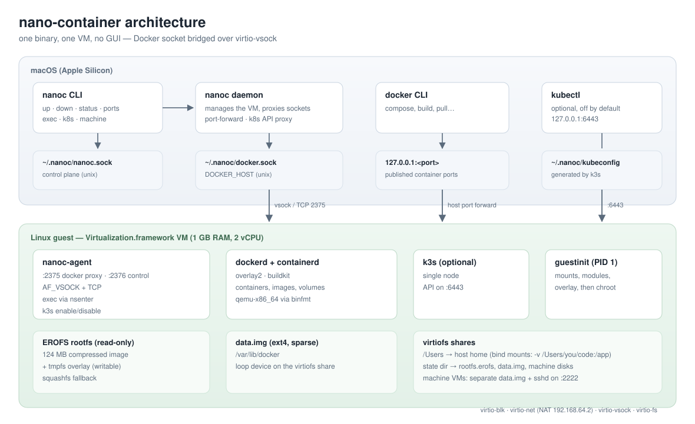
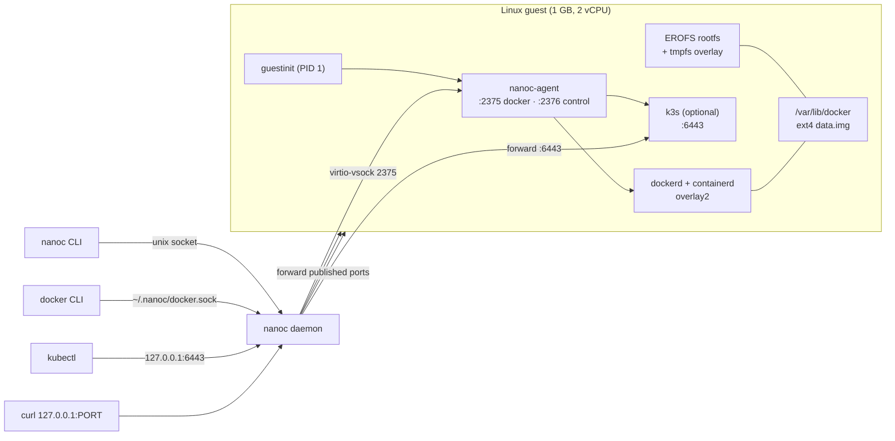

# Architecture

How `nano-container` boots a Linux VM on macOS, runs Docker inside it and exposes
the Docker socket to the host.

## Components

| Piece | Language | Role |
|---|---|---|
| `nanoc` (CLI) | Go | `up`, `down`, `status`; talks to the daemon over a unix socket |
| daemon (same binary, `nanoc daemon`) | Go | owns the VM, injects nothing, publishes the Docker socket |
| `guestinit` | Go (linux/arm64, static) | PID 1 inside the guest: mounts shares, loads modules, builds the root |
| `nanoc-agent` | Go (linux/arm64, static) | listens on TCP inside the guest and forwards to `/var/run/docker.sock` |
| guest rootfs | Alpine | Docker Engine + containerd + runc, no systemd, no sshd |
| kernel | Alpine `virt` | boots with `console=hvc0 rdinit=/guestinit` |

## Boot flow

```
1. nanoc up
     └─ spawns `nanoc daemon` (detached) and waits for the control socket

2. daemon builds the VM configuration
     ├─ LinuxBootLoader(kernel, initramfs) + cmdline `rdinit=/guestinit`
     ├─ 2 vCPU, memory ceiling NANOC_MEM_MB (default: half the Mac's RAM, 2–8 GiB)
     ├─ virtio-net with NAT
     ├─ virtio-balloon (starts at NANOC_MEM_MIN_MB, grows on demand)
     ├─ virtio-vsock (Docker API and agent control)
     ├─ virtio-blk read-only: Alpine modloop (kernel modules)
     ├─ virtio-blk read-write: data.img (Docker data)
     └─ virtiofs share "orbdata": host directory with the compressed rootfs

3. guestinit (PID 1)
     ├─ mount /proc /sys /dev
     ├─ modprobe squashfs, virtiofs, virtio_net, overlay, loop
     ├─ mount share orbdata at /data
     ├─ mount modloop (squashfs) and point /lib/modules at it
     ├─ modprobe ext4, bridge, veth, br_netfilter, nf_tables, iptables…
     ├─ losetup /data/rootfs.sqfs → /ro (squashfs, read-only)
     ├─ tmpfs /rw + overlay(lower=/ro, upper=/rw/upper) → /newroot
     ├─ bind /data into /newroot/data, mount pseudo-fs inside
     └─ chroot /newroot and exec /opt/nanoc-guest.sh

4. guest boot script
     ├─ network: eth0 up, 192.168.64.2/24, default route 192.168.64.1
     ├─ mount /dev/vdb (data.img, ext4) at /var/lib/docker
     ├─ dockerd --storage-driver=overlay2
     └─ nanoc-agent on vsock 2375 (Docker) and 2376 (control)

5. daemon exposes the Docker API
     └─ unix socket ~/.nanoc/docker.sock → virtio-vsock 2375 → docker.sock
```

## Storage

| Data | Where | Format |
|---|---|---|
| Kernel | `assets/Image` | raw arm64 `Image` extracted from the Alpine EFI zboot |
| Initramfs | `assets/initramfs.cpio.gz` | gzip cpio with `guestinit` |
| Modules | `assets/modloop-virt` | squashfs, attached read-only |
| Guest rootfs | `~/.nanoc/rootfs.sqfs` | squashfs + zstd (269 MB dir → 68 MB) |
| Docker data | `~/.nanoc/data.img` | ext4 image, attached as virtio-blk |

Writes to the guest rootfs go to a tmpfs overlay; they are intentionally
ephemeral. Durable state (images, containers, volumes) lives in the ext4 image.

## Networking

- The VM uses Virtualization.framework NAT: guest `192.168.64.2`, host gateway
  `192.168.64.1`.
- Inside the guest, Docker creates `docker0` + iptables rules, so
  `docker run -p 8080:80` publishes on the *guest's* loopback/eth0.
- The host reaches the Docker API and the agent's control channel only over
  virtio-vsock, which only the daemon process can open. The agent does not
  listen on TCP, so other processes on the Mac and other VMs on the NAT
  network cannot reach it (`NANOC_VSOCK=0` turns TCP back on for debugging).
- Ports published by containers are forwarded to `127.0.0.1` on the Mac
  (`0.0.0.0` with `NANOC_LAN=1`).

## Memory

The VM is created with a ceiling (`NANOC_MEM_MB`, default half the Mac's RAM,
2–8 GiB) and the memory balloon holds the guest at a smaller target
(`NANOC_MEM_MIN_MB`, default 1 GiB). Every 2 s the daemon reads `MemAvailable`
and memory PSI from the agent: below 20% free (or PSI above 10) the target grows
by 512 MiB (256 MiB when macOS itself is under critical pressure); after 60 s
with more than half free it shrinks by 256 MiB. The balloon also deflates by
itself on guest OOM. `nanoc status` shows the current target.

Virtualization.framework's balloon has no free page reporting, so pages the guest
has touched are not handed back to macOS: the cost on the Mac is the highest
target reached, not the ceiling. Shrinking still helps, since pages held by the
balloon go cold and macOS compresses or swaps them first. The kernel runs with
`init_on_alloc=0` so inflating the balloon does not touch pages the guest never
used. `NANOC_MEM_DYNAMIC=0` turns this off and gives the guest the full ceiling.

- Idle guest: ~92 MB used (measured with `free -m` at 2 GiB).
- Host daemon RSS: ~9-10 MB.
- Boot to a working Docker socket: ~6 s.

## Design decisions

- **Own PID 1 instead of a distro init.** No systemd, no cloud-init, no SSH
  daemon; the boot path is explicit and small.
- **Compressed read-only rootfs + overlay.** Image is ~4× smaller than the
  directory and the guest cannot corrupt its own base system.
- **Data image as a virtio-blk disk.** A single sparse file on the host, attached
  directly instead of through a loop device on virtiofs, which skips the FUSE
  round trip on every block. `NANOC_DATA_BLK=0` goes back to the loop mount.
  The daemon's lock keeps two VMs from attaching the same image.
- **Modules from the Alpine modloop.** The kernel itself stays small; netfilter,
  ext4 and bridge modules are mounted from a signed squashfs only when needed.
- **vsock for the Docker proxy and control.** Only the process that owns the VM
  can open a vsock connection, so the root-equivalent Docker API and the
  agent's `run`/`exec` commands are not reachable from the network.

## Known limitations

- EROFS is not available in the Alpine `virt` kernel (neither built-in nor as a
  module), hence squashfs.
- No LAN port publishing, no Kubernetes, no Rosetta, no GUI.
- Single VM, fixed 2 vCPU.
- The guest IP is static; there is no DHCP client.

## Diagram



A `docker run` request, end to end (host → virtio-vsock → guest):




